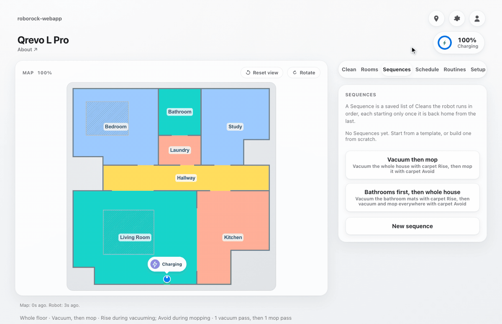
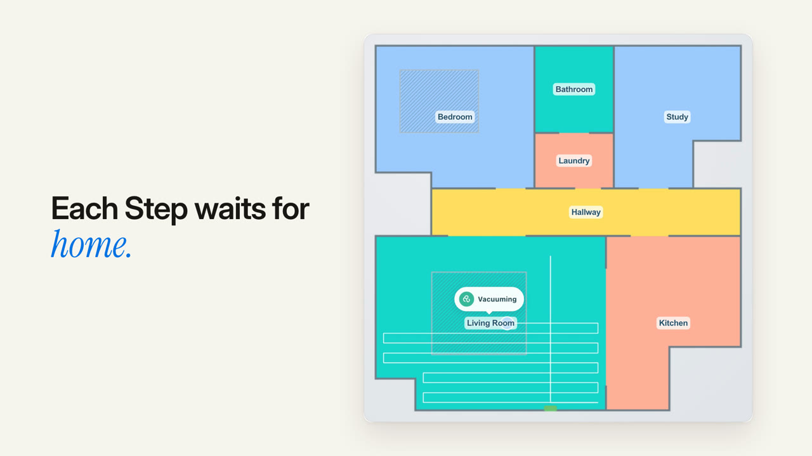

# roborock-webapp

A self-hosted web app for Roborock robot vacuums that runs multi-step cleans the official
app can't, such as "vacuum the carpets first, then mop around them".

[](LICENSE)
[](pyproject.toml)



The recording above is fake mode: a simulated robot in a synthetic apartment, sped up
during the cleaning. It needs no account and no robot, so you can run it yourself in
about 30 seconds. ([MP4 version](docs/media/demo.mp4),
[light](docs/media/screenshot-light.png) and [dark](docs/media/screenshot-dark.png)
screenshots, [landing page](https://site-mu-ten-70.vercel.app) with source in `site/`.)

[](docs/media/launch-film.mp4)

**[Watch the 68-second launch film](docs/media/launch-film.mp4)** (sound on). It shows picking rooms on the
map, building a Sequence, scheduling it for weekdays, queueing the next clean, and installing
the app on a laptop. Everything in it is fake mode.

## Why

The official Roborock app is good at starting one clean. It is not good at chaining them,
and its carpet handling is one global setting. This app adds:

- **Sequences that wait for the robot to come home.** A Sequence is an ordered list of
  Steps. Each Step is its own clean (rooms, mode, carpet behavior), and the next Step
  starts only once the robot has left the dock, cleaned, and returned idle. A mid-job
  recharge does not count as done.
- **Carpet-aware vacuum, then mop.** The built-in Two-Stage Clean vacuums with carpet
  mode Rise (carpets included, mop lifted), then mops with carpet mode Avoid (carpets
  skipped), so the mop never touches a rug.
- **Read-back verification before starting.** Before it starts a clean, the app sets the
  cleaning mode (and the carpet mode, when the clean names one), reads them back from the
  robot, and refuses to start if they do not match what you asked for.
- **Schedules.** Weekly Schedule Rules and per-room cleaning intervals, run by a scheduler
  inside the app process. No cron needed.
- **A Claude assistant that proposes, never acts.** Type "vacuum the kitchen including
  carpets twice" and get a plan to review. Nothing moves until you confirm it.

## Quickstart (fake mode, no account)

Requires [uv](https://docs.astral.sh/uv/). uv fetches Python 3.12 if you don't have it.

```
git clone https://github.com/zarifaziz/roborock-webapp.git
cd roborock-webapp
cp .env.example .env    # fake mode needs only TIMEZONE; set it to your IANA zone
uv sync
uv run uvicorn roborock_auto.adapters.web.server:app --host 127.0.0.1 --port 8000
```

Open http://127.0.0.1:8000. Go to **Sequences**, pick the "Vacuum then mop" template,
save it and press **Run**. The fake robot departs, cleans and returns on a clock, so a
two-Step run takes a little over a minute.

`TIMEZONE` is required in every mode, fake included. There is deliberately no default:
an implicit "system local" resolves to UTC inside a container and silently shifts every
schedule.

## Going live (your Roborock account)

1. In `.env`, set `GATEWAY=live` and `ROBOROCK_EMAIL`. That is all the login and discover
   commands below need; the server itself refuses to start live until step 3 has filled
   in `ROBOROCK_DUID`, `CARPET_RISE_VALUE` and `CARPET_AVOID_VALUE`.
2. Log in once. This sends a code to your email and saves the session to
   `user_data.json` (gitignored, never commit it):
   ```
   uv run python -m roborock_auto.adapters.cli.login
   ```
3. Discover your ids. This is read-only and changes nothing on the robot:
   ```
   uv run python -m roborock_auto.adapters.cli.discover
   ```
   Without `ROBOROCK_DUID` it lists the devices on your account and stops:
   ```
   gateway mode : live
   devices on this account:
     <duid>  <name>  <model>
   Set ROBOROCK_DUID in .env to your robot's duid and run discover again.
   ```
   Put your robot's duid in `ROBOROCK_DUID` and run discover again. It now prints the
   robot's status, a `carpet value : <n>` line, rooms, routines and consumables. Set
   carpet mode to Rise in the Roborock app, run discover, and copy the number into
   `CARPET_RISE_VALUE`;
   then set Avoid, run it again, and copy that number into `CARPET_AVOID_VALUE`. There
   are no defaults for these on purpose, because a wrong value would wet a carpet.
4. Start the server the same way as fake mode. It now drives the real robot.

Once live mode is running, the "Connect your Roborock" panel (Send code, then Connect)
can redo the login from the browser, and the **Discover** button shows a read-only
snapshot of the rooms, routines and consumables.

The commands the live adapter sends, and their parameters, are verified on a Qrevo L Pro
and pinned in `tests/test_cloud_adapter_mapping.py`. Other models may expect different
parameters; if a command misbehaves on yours, please open an issue.

**The web app has no login of its own.** Anyone who can reach the port can drive your
robot. Keep it on `127.0.0.1`, or put it behind something that authenticates (a VPN or
tailnet, or a reverse proxy with auth) before exposing it to a network.

## How it talks to the robot

```
   your machine                                    Roborock cloud
  +-----------------------------+   HTTPS       +--------------------+
  | roborock-webapp (FastAPI)   |-------------->| web API: login,    |
  |   -> python-roborock        |               | home data          |
  |                             |   MQTT        |                    |
  |                             |<------------->| MQTT broker        |
  +-----------------------------+               +--------------------+
                |                                         ^
                | local TCP, when the robot               | MQTT
                | is on the same LAN                      |
                v                                         |
          +-------------------------------------------------+
          |                  robot vacuum                   |
          +-------------------------------------------------+
```

The app uses [python-roborock](https://github.com/python-roborock/python-roborock), the
community library behind the Home Assistant integration. It logs in through Roborock's
cloud with your account, then sends commands over Roborock's MQTT broker, and
python-roborock uses a direct local TCP connection instead when the robot is reachable on
your LAN.

To be clear about what that means: this is Roborock's own cloud and an unofficial,
reverse-engineered API. There is no SLA, Roborock can change it at any time, and the
cloud login endpoint is rate limited (the adapter deliberately does not reconnect on
every failure for that reason). Your robot keeps working with the official app either
way.

## Features

**Map and controls.** A live map with the robot's position, white vacuum trails and
translucent mop coverage from its recorded path, and a badge for its current activity
(including mop washing, drying and returning to the dock). Scroll to zoom, drag to pan,
**Reset view** to recentre; map refreshes keep your view. Start, pause, stop and dock,
find the robot, room selection, fan, mop route and water level, passes, consumables, and
the routines saved in the official app.

**Rooms and carpet.** Rooms shows carpet behavior beside cleaning mode and passes. Rise
includes carpets with the mop lifted; Avoid skips them. Ignore and Cross are documented
Roborock modes but are not offered until their firmware commands are verified for this
integration. Review the exact job before starting; settings are read back from the robot
first. The latest cleaning record reports completion, duration and area separately from
the app's own record of requested rooms.

**Sequences.** A Sequence is a named, ordered list of Steps, each a clean with its own
rooms, mode and carpet setting, each starting only once the robot is home from the last.
For example: vacuum the two bathrooms with carpet Rise so the bath mats get vacuumed, then
vacuum and mop the whole house with carpet Avoid so the robot stays off the big carpets.
When a Sequence finishes, it leaves carpet mode at Avoid. The Two-Stage Clean is the built-in two-Step preset
of the same runner. Only one run drives the robot at a time, whether it was started from
the browser or by the scheduler; cancelling sends the robot home with carpet Avoid.

**Up next.** Ask for a clean while the robot is busy and it waits in Up next instead of
failing. The head entry starts once the robot is home, idle and error-free. The list only
advances after a success: a failure, a cancel, or sending the robot home puts it on hold
until you resume or clear it.

**Scheduling.**

- **Room Intervals**: `POST /intervals` says how often a room should be cleaned. The app
  derives "last cleaned" from every clean it has started (any entry point) and scores each
  room's Priority; `GET /overdue` lists them worst-first, and `POST /clean/overdue` cleans
  everything currently Overdue in one call.
- **Schedule Rules**: `POST /schedules` names a weekly grid of days plus a time of day,
  and an Action: a single clean (the whole house or chosen rooms, in a chosen mode), or a
  saved Sequence. A scheduler task in the same FastAPI process turns each Rule into
  Occurrences and fires them through the same code path the UI button uses.
- **Sequences API**: `/sequences` saves, edits and deletes them; `POST /sequences/{id}/run`
  starts one, `GET /sequences/progress` reports whichever run holds the robot, and
  `POST /sequences/cancel` stops it.
- `GET /scheduler/status` reports the last tick, the resolved timezone, and whether the
  scheduler is erroring; `GET /occurrences` is the firing timeline.

Cleaning Runs, Schedule Rules, Occurrences, Room Intervals and Sequences are stored in
SQLite (`DATABASE_PATH`, default `roborock.db`).

**Cleaning assistant (optional).** Set `ASSISTANT_ENABLED=true` and optionally
`ASSISTANT_MODEL=sonnet` in `.env`, then restart. Authenticate Claude Code as the user
running the server, or set `ANTHROPIC_API_KEY`. The app uses the Python Claude Agent SDK
to turn requests such as "Vacuum the kitchen including carpets twice" into a plan you
review and confirm before the robot moves. Questions about previous cleans are answered
from recorded evidence; an app start request is never treated as proof that a room was
cleaned. Your prompt, room names and recent cleaning records are sent to Claude when you
ask. The assistant has no robot, filesystem, shell or MCP tools, and each request is
bounded by a 60 second timeout, 3 turns and a $0.20 budget. Manual controls work when the
assistant is disabled or unavailable.

**Unattended two-stage clean.** `uv run python -m roborock_auto.adapters.cron.run` runs
the Two-Stage Clean once and exits non-zero on failure. `.github/workflows/clean.yml`
can run it on GitHub Actions; its schedule is commented out by default. Enable it by adding
the `ROBOROCK_USER_DATA` secret and the repo variables, then uncommenting the cron. A
Schedule Rule covers most recurring cleans without it.

**Install to a phone (PWA).** The app ships a root-scoped service worker, a manifest and
icons, so "Add to Home Screen" opens it standalone with the shell available offline.
Robot state and commands are never cached: offline you get the shell and an offline
banner, not stale data. Service workers need a secure context (HTTPS, or
`localhost`/`127.0.0.1`), so over a plain LAN address such as `http://192.168.x.x:8000`
the app works but cannot install. To install on a phone, serve it over HTTPS, for example
with a reverse proxy or a tailnet HTTPS certificate.

## Architecture

Ports and adapters with a small domain core. The vendor library is imported in exactly
one package (`adapters/roborock_cloud/`); everything else speaks the app's own types.
Knowledge about how the robot behaves (for example, "docked and charging mid-job does not
mean done") lives in pure policy functions in `domain/policies.py`. A first-class fake
adapter simulates the robot on a clock, which is what powers both the demo above and a
test suite that runs in seconds.

```
  web UI / scheduler / cron / CLI      (driving adapters)
              |
        application/                   Sequence runner, Up next, scheduler, retry
              |
     domain/ + ports/                  value objects, policies, role-split interfaces
              |
  roborock_cloud | fake | sqlite       (driven adapters)
```

[ARCHITECTURE.md](ARCHITECTURE.md) is the full document. [CONTEXT.md](CONTEXT.md) defines
the domain language (Clean, Step, Sequence, Up next, Schedule Rule, Occurrence), and
[docs/adr/](docs/adr/) records the decisions behind it.

## Supported devices

Built and tested on a **Roborock Qrevo L Pro**. It should work with other Roborock
vacuums supported by python-roborock, but none have been tested. If you try it on another
model, please open an issue with what worked and what didn't; PRs for other devices are
welcome.

## Development

```
uv sync --extra dev
uv run pytest                                       # whole suite, no account needed
uv run ruff check . && uv run ruff format .
uv run --with playwright python tests/browser/map_interactions.py   # map browser checks
```

The browser checks run against mocked requests in an installed Google Chrome. Other
entrypoints: `python -m roborock_auto.adapters.cli.login`,
`python -m roborock_auto.adapters.cli.discover` and
`python -m roborock_auto.adapters.cron.run`.

## Contributing

Issues and PRs are welcome, especially device reports. Before a larger change, read
[ARCHITECTURE.md](ARCHITECTURE.md) section 10 for where new code goes. Two rules matter
most: a vendor type or firmware integer outside `adapters/roborock_cloud/` is a bug, and
every new port method lands in the fake adapter in the same change as the live one.

## Credits

Talking to the robot is entirely thanks to
[python-roborock](https://github.com/python-roborock/python-roborock) and its
contributors. This project is not affiliated with or endorsed by Roborock.

## License

[MIT](LICENSE)
